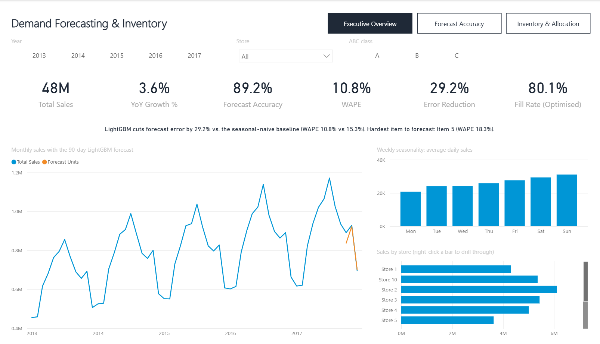
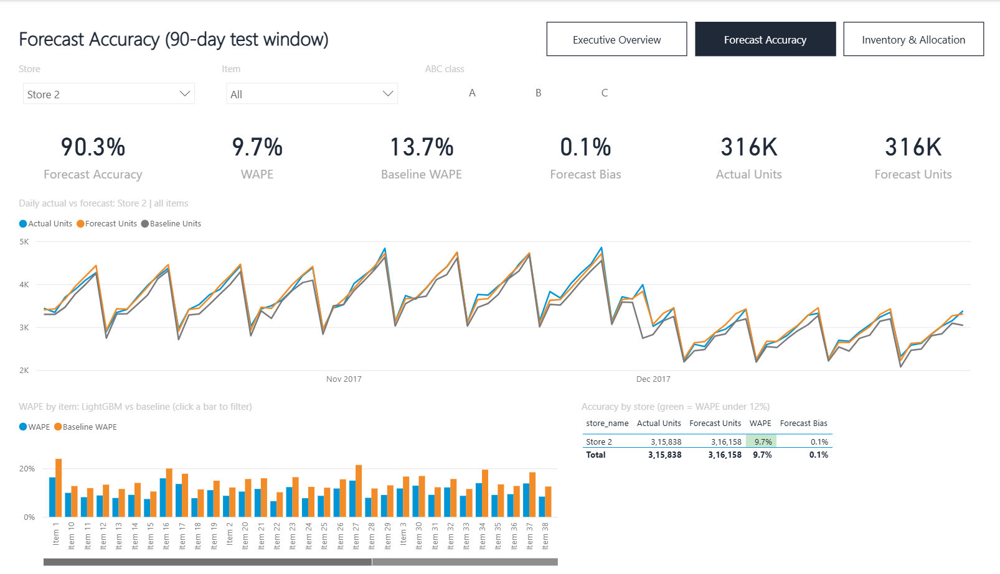
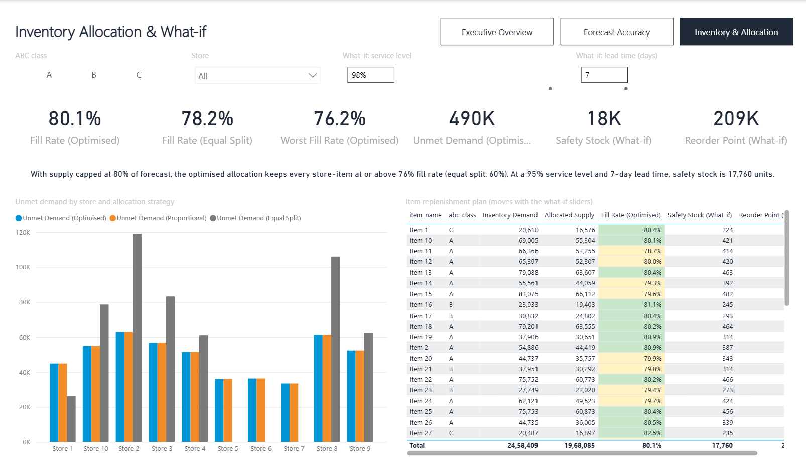
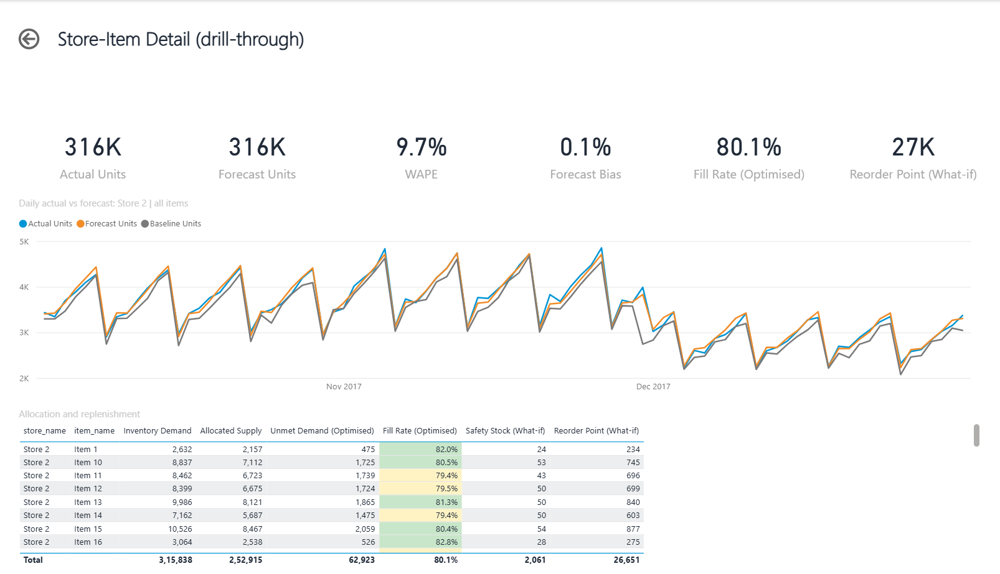
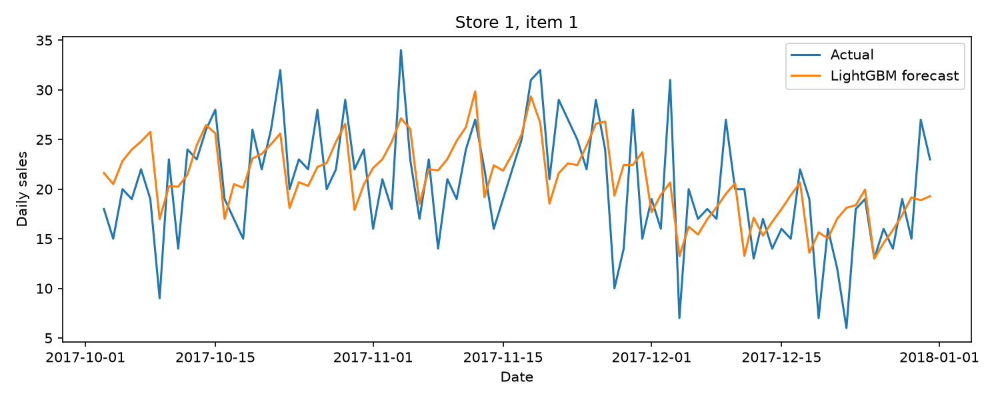
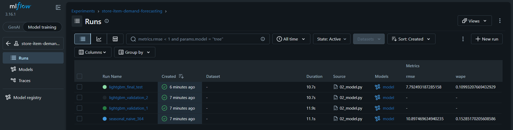

# Demand Forecasting and Inventory Optimization

End-to-end retail demand analytics: Spark feature engineering, a LightGBM forecast benchmarked against a seasonal-naive baseline, inventory allocation under constrained supply, SQL KPI analysis and a three-page Power BI dashboard.

## Business question

A retailer with 10 stores and 50 items needs to know (1) how much each store will sell over the next 90 days and (2) how to split limited stock across stores so the fewest customers walk away empty-handed.

## Key results

<!-- RESULTS_START -->
Data: 913,000 daily sales rows (10 stores × 50 items, 2013–2017). Test window: the final 90 days (3 Oct – 31 Dec 2017), never seen during training or tuning.

**Forecasting**

| Model | WAPE | RMSE | Bias |
| --- | ---: | ---: | ---: |
| Seasonal-naive (same day last year) | 15.3% | 10.90 | -4.2% |
| **LightGBM (tuned)** | **10.8%** | **7.68** | **+0.1%** |

- LightGBM cuts forecast error by **29%** against the seasonal-naive baseline and is almost unbiased in total (+0.1% vs -4.2%).
- The hardest items to forecast are low-volume C-class items (WAPE 16–18%). High-volume A items forecast best, so planner review should focus on the long tail.

**Inventory allocation** (supply capped at 80% of forecast: 1.97M units for 2.46M units of actual demand)

| Strategy | Fill rate | Unmet units | Worst store-item fill rate | Store-items below 70% |
| --- | ---: | ---: | ---: | ---: |
| **Optimised (PuLP, expected shortage + fairness)** | **80.1%** | **490,324** | **76.2%** | **0** |
| Proportional to forecast | 80.1% | 490,324 | 76.2% | 0 |
| Equal split across stores | 78.2% | 536,376 | 60.3% | 122 |

- Forecast-driven allocation serves **46,052 more units** than an equal split and lifts the worst store-item from 60% to 76% fill, leaving no store-item below 70% instead of 122.
- The optimised and proportional splits score the same here. When stock is short everywhere, total unmet demand is roughly demand minus supply for any split that never over-allocates. The optimiser's added value is that it handles stores whose forecasts differ in uncertainty, and the fairness term stops it loading the shortfall onto a few stores.
<!-- RESULTS_END -->

## Approach

| Step | Script | What it does |
| --- | --- | --- |
| 1 | `01_features.py` | Reads the Kaggle data with Spark, checks for nulls, duplicate keys and missing dates, and builds calendar, US federal holiday, lag (91/182/364 days) and shifted rolling-mean features. The final 90 days form the test window; every demand-history feature is at least 91 days old, so the forecast never sees test-window sales. |
| 2 | `02_model.py` | Benchmarks a 364-day seasonal-naive baseline against LightGBM. Six LightGBM configurations are compared on a 90-day validation window before the test window, with store and item treated as categorical features. The winner is refit on all pre-test data. Every run is logged to MLflow, and WAPE, RMSE and bias are reported. |
| 3 | `03_inventory.py` | Calculates safety stock and reorder points from **validation-window** forecast errors, then allocates each item's limited supply across stores with PuLP/CBC, minimising expected shortage. Optimised, proportional-to-forecast and equal-split allocations are scored against actual test-window demand (unmet units and fill rate). |
| 4 | `04_powerbi_export.py` | Exports a star schema (`fact_sales`, `fact_forecast`, `fact_inventory`, `dim_date`, `dim_store`, `dim_item` with ABC class) as CSV and as a SQLite database. |
| 5 | `05_sql_kpis.py` | Runs the KPI queries in `sql/` against the SQLite database and saves the results to `outputs/sql_results/`. |
| 6 | `powerbi/build_pbip.py` | Generates the Power BI project `powerbi/DemandForecasting.pbip`: the semantic model (TMDL, relationships, DAX measures) and the report (PBIR). |

### SQL analysis (`sql/`)

1. Year-over-year sales growth by store (window `LAG`)
2. Weekday seasonality index
3. Forecast accuracy by store vs. baseline
4. Items ranked by forecast error with ABC class (`RANK`)
5. Weekly forecast vs. actual and bias
6. Top 20 stockout-risk store-item pairs
7. Allocation strategy comparison by ABC class

### Power BI dashboard (`powerbi/`)

- **Executive Overview**: KPI cards (sales, YoY growth, forecast accuracy, WAPE, error reduction, fill rate), a dynamic insight sentence, monthly sales with the 90-day forecast, weekday seasonality and sales by store.
- **Forecast Accuracy**: daily actual vs. LightGBM vs. baseline with a title that follows the slicers, WAPE by item, and an accuracy table by store with traffic-light colouring.
- **Inventory & Allocation**: fill rate and unmet demand by allocation strategy, plus **what-if sliders** for service level and lead time that recalculate safety stock and reorder points in DAX (`NORM.S.INV`).
- **Store-Item Detail** (drill-through): right-click any store or item to see its daily forecast, accuracy and replenishment plan.

Interactivity: page-navigation buttons, year/ABC button slicers, store/item dropdowns, cross-filtering between visuals, drill-through, and conditional formatting driven by DAX colour measures.

DAX highlights: `WAPE`, `Forecast Bias`, `Error Reduction`, `YoY Growth %`, `Fill Rate` and `Worst Fill Rate` per strategy, what-if `Safety Stock` / `Reorder Point`, and text measures for the insight sentences (`TOPN`, `CONCATENATEX`, `FORMAT`).

## Assumptions

- `ASSUMPTION_LEAD_TIME_DAYS = 7` days.
- `ASSUMPTION_SERVICE_LEVEL = 0.95`; the safety-stock z-score comes from the standard normal distribution.
- `ASSUMPTION_SUPPLY_FRACTION = 0.8` of each item's total forecast demand over the test window, so there is deliberately not enough stock.
- `ASSUMPTION_DAILY_ERRORS_INDEPENDENT = True` when adding up daily forecast-error spread over the horizon.
- US holidays are US federal holidays, including observed dates.
- ABC classes: A = items making up the first 80% of total sales, B = the next 15%, C = the rest.

## Limitations

- Lead time, service level and supply fraction are assumptions, not values from the data.
- Expected shortage assumes daily errors are independent and normally distributed.
- When forecast errors are similar across stores, as in this dataset, the optimised allocation lands very close to a simple proportional split. Its benefit grows when forecast uncertainty differs a lot between stores.
- This is a simulated inventory scenario on public Kaggle data, not company data.

## Screenshots

**Executive Overview**



**Forecast Accuracy** (filtered to Store 2)



**Inventory & Allocation** (what-if parameters)



**Store-Item Detail** (drill-through page for Store 2)



**Forecast vs. actual for one store-item** (Python)



**MLflow experiment runs**



## Run

Data: download `train.csv` from the Kaggle [Store Item Demand Forecasting Challenge](https://www.kaggle.com/competitions/demand-forecasting-kernels-only/data) and place it in this folder.

Requirements: Python 3.13, a JDK with `JAVA_HOME` set (verified with JDK 23 and PySpark 4.2.0), and Power BI Desktop for the dashboard. Spark may print a missing-`winutils.exe` warning on Windows; the workflow avoids Spark filesystem writes, so it is safe to ignore.

```powershell
$env:Path = "$env:JAVA_HOME\bin;$env:Path"
py -3.13 -m venv .venv
& '.venv/Scripts/python.exe' -m pip install -r requirements.txt
& '.venv/Scripts/python.exe' 01_features.py
& '.venv/Scripts/python.exe' 02_model.py
& '.venv/Scripts/python.exe' 03_inventory.py
& '.venv/Scripts/python.exe' 04_powerbi_export.py
& '.venv/Scripts/python.exe' 05_sql_kpis.py
& '.venv/Scripts/python.exe' powerbi/build_pbip.py
```

Open `powerbi/DemandForecasting.pbip` in Power BI Desktop and click **Refresh**. `build_pbip.py` sets the `DataFolder` parameter to this clone's `outputs/powerbi/` folder; if you move the folder, rerun it or change the parameter under **Transform data > Edit parameters**.

MLflow UI:

```powershell
& '.venv/Scripts/python.exe' -m mlflow ui --backend-store-uri sqlite:///mlruns/mlflow.db
```

Open `http://127.0.0.1:5000`.
